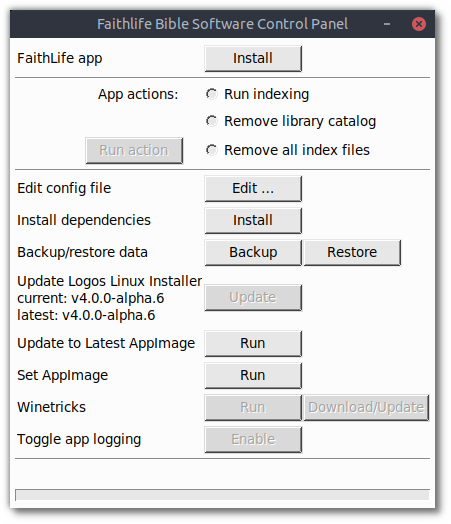

# Manual testing results

## Optarg testing

| Optargs | latest version tested | result | notes
| :--- | :--- | :---: | :--- |
| `-v/--version` | `main-20240426-09cb40d` | :+1: |
| `-F/--skip-fonts` | `4.0.0-alpha.6` | :+1: |
| `-a/--check-for-updates` | | |
| `-K/--skip-dependencies` | `4.0.0-alpha.6` | :+1: |
| `-V/--verbose` | `main-20240426-09cb40d` | :+1: |
| `-D/--debug` | `main-20240426-09cb40d` | :+1: |
| `-c/--config` | | |
| `-f/--force-root` | | |
| `-p/--custom-binary-path` | | |
| `-L/--delete-log` | `4.0.0-alpha.6` | :+1: |
| `--install-app` | `4.0.0-alpha.6` | :+1: |
| `--run-installed-app` | `4.0.0-alpha.6` | :+1: |
| `--run-indexing` | | |
| `--remove-library-catalog` | | |
| `--remove-index-files` | | |
| `--edit-config` | `main-20240426-09cb40d` | :-1: | gnome-text-editor symbol lookup error: /lib/x86_64-linux-gnu/libcairo.so.2: undefined symbol: FT_Get_Transform
| `--install-dependencies` | `main-20240426-09cb40d` | :+1: |
| `--backup` | | |
| `--restore` | | |
| `--update-self` | | |
| `--update-latest-appimage` | | |
| `--set-appimage` | | |
| `--get-winetricks` | | |
| `--run-winetricks` | `4.0.0-alpha.6` | :+1: |
| `--toggle-app-logging` | `4.0.0-alpha.6` | :+1: |
| `--create-shortcuts` | | |
| `--remove-install-dir` | `4.0.0-alpha.6` | :+1: |
| `--dirlink` | | |
| `--check-resources` | | |

## TUI testing

| Option | latest version tested | result |
| :--- | :--- | :---: |
| Install [app] | `4.0.0-alpha.6` | :+1: |
| Run app | `4.0.0-alpha.6` | :+1: |
| Run indexing |||
| Remove all index files |||
| Run Winetricks | `4.0.0-alpha.6` | :+1: |
| Download/Update Winetricks |||
| Edit Config | `4.0.0-alpha.6` | :+1: |
| Back up Data |||
| Restore Data |||
| Enable/Disable [app logging] |||
| Update to Latest AppImage |||
| Set AppImage |||
| Install Dependencies |||

## GUI testing

| Button/Action | latest version tested | result |
| :--- | :--- | :---: |
| Install [app] | `4.0.0-alpha.6` | :+1: |
| Run app | `4.0.0-alpha.6` | :+1: |
| Run indexing |||
| Remove library catalog |||
| Remove all index files |||
| Edit... [config file] | `main-20240426-09cb40d` | :-1: | Ubuntu 24.04: gnome-text-editor symbol lookup error: /lib/x86_64-linux-gnu/libcairo.so.2: undefined symbol: FT_Get_Transform
| Install [dependencies] | `main-20240426-09cb40d` | :-1: | Ubuntu 24.04: fails to prompt for password
| Backup |||
| Restore |||
| [Self-]Update |||
| Run [Update to Latest AppImage] |||
| Run [Set AppImage] |||
| Run [Winetricks] | `4.0.0-alpha.6` | :+1: |
| Download/Update [Winetricks] |||
| Enable/Disable [app logging] |||
## Wine runtime selection

Use an existing test installation with Logos and its indexer stopped. Switching
Wine does not roll back changes a Wine build subsequently makes to the prefix.

1. GUI: open **Wine runtime → Select…**. TUI: choose **Select Wine runtime…**.
   CLI: run `oudedetai --select-wine`. Check that the current executable is shown.
2. Choose an AppImage in Downloads without execute permission. Confirm that the
   managed copy becomes executable, the original is unchanged, and launching
   Logos uses the selected version. Restart Ou Dedetai and check the selection.
3. Select another installed AppImage, then switch back. Check `wine --version`
   via `oudedetai --wine --version` and launch Logos with each selection.
4. Select system Wine, local Proton, and a custom Wine executable in turn. For
   an uninstalled Wine build, check detection of `server/wineserver`, or select
   its matching server explicitly when prompted. Check the selected runtime in
   the Wine log and test launching Logos and the indexer.
5. Cancel both a menu and a file dialog. Try an invalid AppImage or an executable
   that fails `--version`. Confirm the prior selection remains active.
6. Start Logos or indexing, then attempt a switch. Confirm the manager asks you
   to stop them without changing the selection.
7. From an AppImage installation, test **Update to Latest AppImage** when an
   update exists. Confirm it activates and persists the downloaded runtime.
